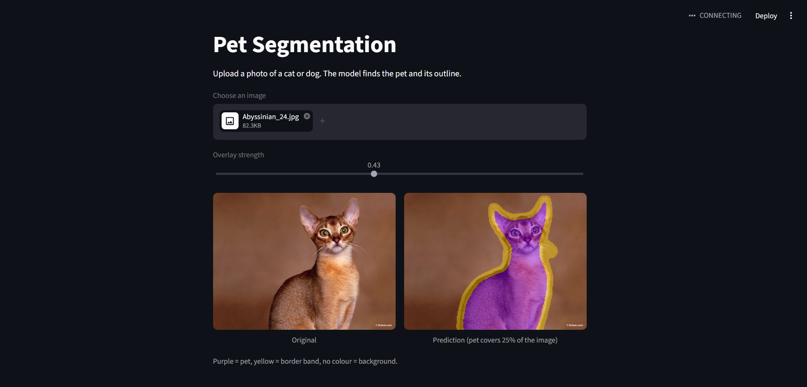
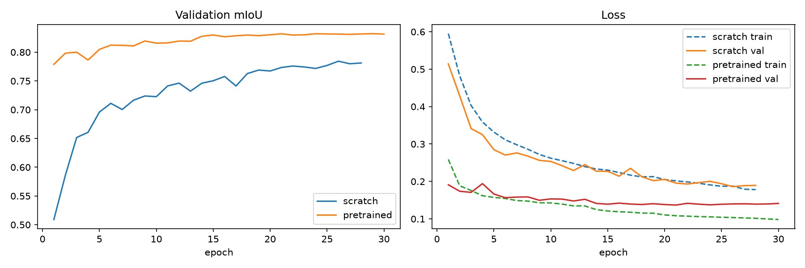
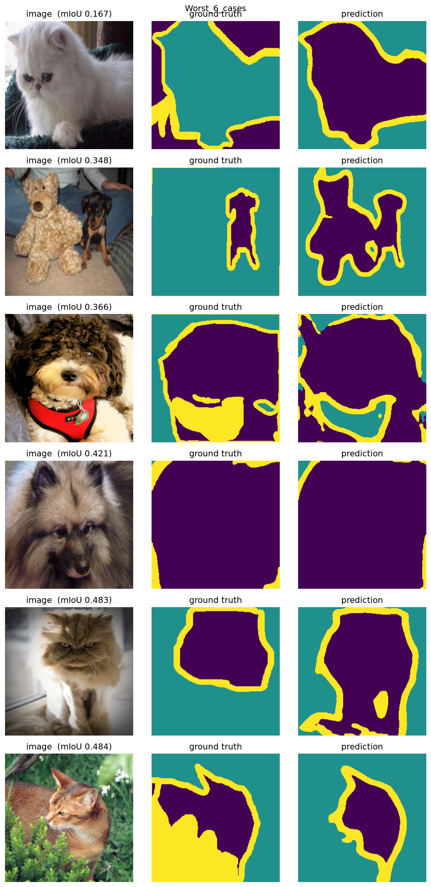

# Pet Segmentation: U-Net from Scratch vs Pretrained ResNet34

Semantic segmentation of cats and dogs on the Oxford-IIIT Pet dataset. I built a U-Net from scratch in PyTorch, then compared it with a U-Net that uses a pretrained ResNet34 encoder, under identical training settings.



## Results (test set, 1,101 images)

Both models were scored on a test set that was never used for training or checkpoint selection.

|                           | Scratch U-Net | ResNet34 U-Net |
| ------------------------- | ------------- | -------------- |
| **mIoU**                  | 0.780         | **0.829**      |
| mDice                     | 0.868         | **0.900**      |
| Pixel accuracy            | 0.918         | **0.943**      |
| IoU: pet                  | 0.849         | **0.902**      |
| IoU: background           | 0.918         | **0.948**      |
| IoU: border               | 0.572         | **0.636**      |
| Parameters                | 31.0M         | 24.4M          |
| Time per epoch (RTX 4050) | ~320 s        | ~98 s          |

Validation and test scores agree within 0.004 mIoU for both models (scratch 0.784 vs 0.780, pretrained 0.832 vs 0.829), so the results generalise.

**Takeaways**

- Pretraining gives **+0.049 mIoU** and trains about 3x faster per epoch. The pretrained model matched the scratch model's best score within 2 epochs.
- The largest relative gain is on the **border** class, where pretrained features help most with fine detail.
- Border is the weakest class for both models (see error analysis).

### Training curves



## Data

- Source: [Oxford-IIIT Pet](https://www.robots.ox.ac.uk/~vgg/data/pets/), 3-class trimaps: pet, background, border.
- 7,390 images, of which **7,335 were used**. I excluded 41 images with no annotation entry and 14 annotated images whose masks contain no pet pixels (visible animals labelled as all background).
- 12 non-RGB images (GIF, RGBA, grayscale) are converted to RGB on load.
- Stratified 70/15/15 split by breed (seed 42): 5,134 train, 1,100 val, 1,101 test. All 37 breeds appear in every split with zero overlap. The split is saved in `data/processed/split.csv`.
- Images are resized to 256x256 (bilinear for images, nearest-neighbour for masks, so class labels are never blended).

## Method

|                           |                                                                                                   |
| ------------------------- | ------------------------------------------------------------------------------------------------- |
| Augmentation (train only) | horizontal flip, small shift/scale/rotate, brightness/contrast, applied jointly to image and mask |
| Loss                      | 0.5 x cross-entropy + 0.5 x soft Dice                                                             |
| Optimizer                 | Adam, batch size 8                                                                                |
| Scheduler                 | ReduceLROnPlateau on validation mIoU (factor 0.5, patience 3)                                     |
| Training                  | up to 30 epochs, early stopping (patience 7), best checkpoint by validation mIoU                  |
| Scratch model             | U-Net, 4 down / 4 up stages, 64 to 1024 channels, LR 1e-3                                         |
| Pretrained model          | ResNet34 (ImageNet) encoder + U-Net decoder, encoder LR 1e-4, decoder LR 1e-3                     |

Metrics (IoU, Dice, pixel accuracy) are accumulated as pooled pixel counts over the whole evaluation set rather than averaged per batch, so large and small images are weighted correctly.

## Error analysis

I scored every test image individually with the pretrained model (mean per-image mIoU 0.821, median 0.836, best 0.920). Only **6 of 1,101 images (0.5%) score below 0.5 mIoU**, and the worst cases are mostly not model failures:



| Per-image mIoU | What happened                                                                                                          |
| -------------- | ---------------------------------------------------------------------------------------------------------------------- |
| 0.167          | **Label error.** The mask marks the cat as background and the sofa as pet. The model's prediction is actually correct. |
| 0.348          | **Ambiguous scene.** A teddy bear next to a dog; the model also segments the toy.                                      |
| 0.366          | **Clothing.** Ground truth labels a harness as border; the model labels it background.                                 |
| 0.421          | **Pet fills the frame.** A few edge pixels of non-pet dominate the score.                                              |
| 0.483          | **Under-segmented label.** The ground truth covers less of the cat than the model does.                                |
| 0.484          | **Camouflage and label noise** around a cat in plants.                                                                 |

**Border class (IoU 0.64).** The trimap border is a hand-drawn band of inconsistent width, so a large part of the border error is a labelling limit rather than a model limit.

## Limitations

- The scratch run was stopped at epoch 28 of 30 and was still improving slowly, so the true gap to the pretrained model is probably slightly smaller than 0.049 mIoU.
- Single run per model (one seed), so there are no confidence intervals.
- The pretrained model shows mild overfitting after about epoch 15 (train loss keeps falling while validation loss is flat); the saved checkpoint is the best validation epoch.
- Ground-truth errors remain in the test set (for example one inverted mask). I report numbers on the full set instead of removing bad images after seeing results.
- Trained on cats and dogs only. Other subjects (or photos with no pet) give meaningless output.
- 256x256 input limits fine detail such as whiskers and fur edges.

## Run it

```bash
pip install -r requirements.txt

# Train (from the project root)
python -m src.train --model scratch
python -m src.train --model pretrained

# Evaluate both models on the test set
python -m src.evaluate

# Launch the app
python -m streamlit run app.py
```

The app uses `models/unet_pretrained_best.pth`. Model weights are not stored in git; download `unet_pretrained_best.pth` from the Releases page and place it in `models/`.

## Project structure

```
segmentation-Unet/
├── app.py                  Streamlit app (upload, predict, overlay)
├── src/
│   ├── dataset.py          Dataset, augmentation, DataLoaders
│   ├── model.py            U-Net, PretrainedUNet (ResNet34)
│   ├── losses.py           Dice loss, combined loss
│   ├── metrics.py          IoU, Dice, pooled SegmentationMetrics
│   ├── train.py            Training loop, validation, checkpointing
│   ├── evaluate.py         Test-set evaluation
│   └── inference.py        Single-image prediction
├── notebooks/              Exploration and checks (01 to 06)
├── data/processed/split.csv
├── outputs/                Logs and figures
└── requirements.txt
```

## Notes

- Albumentations prints a warning that `ShiftScaleRotate` is a special case of `Affine`. It does not affect results; I kept it so both runs used identical augmentation.
